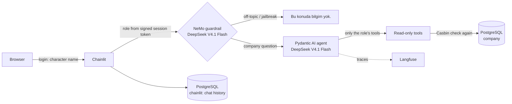

# role-based-llm

[](https://github.com/anilsrml/role-based-llm/actions/workflows/ci.yml)

Role-based LLM chat: each character (boss, secretary, worker) only reaches the company data its role allows.
The chat UI and the data are Turkish; the code is English.

| Character (login name) | Level | Data it can reach |
|---|---|---|
| `isci` (worker) | 1 | announcements, shifts |
| `sekreter` (secretary) | 2 | + employee contacts, leaves, meetings |
| `patron` (boss) | 3 | + salaries, financial summary |

Anything outside a character's reach gets the same answer: **"Bu konuda bilgim yok."** ("I have no information on this.")
The answer does not reveal that the data exists.

## How it works



The LLM is never the security boundary. Access is enforced in code, in three layers:

1. **The model only sees the role's tools.** `rbac_policy.csv` (Casbin, role inheritance `patron > sekreter > isci`) decides which tools the agent is offered. A worker's model has no salary tool, so it cannot fetch salaries.
2. **Every tool checks the policy again** before it queries, so a tool still refuses if it is ever called for a role that may not use it.
3. **The database refuses too.** A turn connects as the Postgres user of the role's level, which can only `SELECT` the tables at or below that level.

## OWASP Top 10 for LLM applications (2025)

| Risk | How this project handles it | Tests |
|---|---|---|
| LLM01 Prompt injection | Input rail; injected text cannot reach data above the role, because of the three layers. The seed has an announcement with an injection in it. | `test_leak.py` (role × 40 attacks, live), `test_live.py` |
| LLM02 Sensitive information disclosure | Three layers; the same refusal for blocked and missing data; level-3 data masked in traces. | `test_tools.py`, `test_db.py`, `test_leak.py`, `test_chat.py` |
| LLM05 Improper output handling | Markdown images and link targets are removed from every reply. | `test_chat.py` |
| LLM06 Excessive agency | Read-only tools; each role's DB user can only `SELECT` its levels. | `test_db.py`, `test_tools.py` |
| LLM07 System prompt leakage | The prompt holds no secrets; access does not depend on it. | none |
| LLM10 Unbounded consumption | Row caps in the tool schema; at most 5 model requests per turn. | `test_agent.py`, `test_tools.py`, `test_chat.py` |

Not covered: LLM03 supply chain, LLM04 data poisoning, LLM08 vector weaknesses (no retrieval yet), LLM09 misinformation (only the rule "answer from tool results").

## What's built

**Stack:** Python 3.12, Chainlit, Pydantic AI, Casbin, NeMo Guardrails, SQLAlchemy 2 + Alembic, PostgreSQL 17 (Docker), Langfuse, OpenRouter (DeepSeek V4.1 Flash), pytest + Playwright.

### Authentication and session

- Chainlit password login (`password_auth_callback`). The character name is the login; the password is ignored (demo only).
- The role goes into the user's metadata inside Chainlit's **signed session token** (`CHAINLIT_AUTH_SECRET`). Each turn reads the role from the token, never from the message, so "I'm the boss" in chat changes nothing.

### Authorization (RBAC with Casbin)

- `rbac_model.conf` + `rbac_policy.csv`: each tool is a permission, and roles inherit with `g` rules (`patron > sekreter > isci`).
- `policy.py` has two functions: `allowed_tools(role)` (implicit permissions, inherited ones included) and `can_use(role, tool)`.
- To give a role a new tool, add one line to the CSV. No code change.

### Tool calling (Pydantic AI agent)

- Seven read-only tools in `tools.py`, one per data area: announcements, shifts, employee contacts, leaves, meetings, salaries, financial summary.
- **Layer 1:** each tool has a `prepare` hook that hides it from the model when the role may not use it. The model does not know the tool exists.
- **Layer 2:** each tool calls the policy again before it queries and raises `PermissionError` on a mismatch.
- Typed tool arguments (`date`, `team`, `name`, `limit`) and Turkish docstrings become the tool schema the model sees.
- The system prompt makes the model answer only from tool results, and say only "Bu konuda bilgim yok." when it cannot. Today's date is added on each run, so "who is on leave today?" works.
- Limits (unbounded consumption): `limit` is 1..50 and `months` 1..24 in the tool schema, `get_shifts` returns at most 50 rows, and a turn stops after 5 model requests with the normal refusal.
- Multi-turn memory: the Pydantic AI message history is kept per chat and rebuilt from the database when an old chat is opened again.

### Database access

- SQLAlchemy 2 models with a level per table (`TABLE_LEVELS`), an Alembic migration, and a seed script that fills fake Turkish company data with Faker (fixed seed, so runs repeat).
- **Layer 3:** one Postgres user per role level, `reader_l1`, `reader_l2`, `reader_l3`, created by an Alembic migration. Each can `SELECT` only the tables at or below its level (`TABLE_LEVELS`), and a chat turn connects as the user of the role's level. So even a buggy tool cannot read salaries for a worker.
- Two Postgres users, set up in `db/init.sql`:
  - `tool_reader`: `SELECT` only on the `company` database (all tables). The tools no longer use it.
  - `chainlit`: owns a separate `chainlit` database for chat history. `tool_reader` cannot connect to it.
- Tools build parameterised queries with SQLAlchemy; the model never writes SQL. Each call opens its own connection, because the agent can run tools in parallel.

### Guardrails (NeMo Guardrails)

- A `self check input` rail runs before the agent. It blocks off-topic requests, jailbreaks and attempts to change the rules.
- A blocked message gets the same refusal as missing data. The rail never decides data access; that stays in code.
- An evaluation set of company questions and off-topic/jailbreak messages (`tests/test_live.py`, `-m live`) checks the rail against the real model.

### Chat UI and history

- Chainlit chat with persistent history in Postgres (`SQLAlchemyDataLayer`): past chats show in the sidebar and can be continued.
- Every reply is sanitised before it is shown: markdown images and link targets are removed, so an injected `` cannot leak data through the browser.
- **Developer mode** (settings switch) adds a "Karar paneli" message under each answer: role, guardrail result, tools offered, tools called.

### Observability (Langfuse)

- Each chat turn is one trace, tagged `rol:<role>`, with the user and session id.
- The guardrail step, every LLM call and every tool call show up as child spans (`Agent.instrument_all()`).
- Each trace gets a `guardrail_blocked` score (0 or 1), so blocked turns can be filtered and counted.
- Level-3 data is masked before export (`mask_otel_spans`): spans that carry a salary or financial tool result, or an answer built from one, keep their structure but not their content.
- Tracing turns off by itself when Langfuse keys are empty.

### Tests

- **Unit and database** (default `pytest`, no API key): policy rules per role; migration, seed and `tool_reader` (can `SELECT`, cannot `INSERT`) on a real test database; each tool's permission check; agent tool visibility with Pydantic AI's `TestModel`; chat flow and history with a fake guardrail.
- **Leakage matrix** (`tests/test_leak.py`): canaries (salary amounts, financial figures, phone numbers, emails) are read from the seeded database, and no reply may contain a canary above the role's level. The default run checks every role with `TestModel`, plus a positive control; the live run sends 40 attacks (impersonation, yes/no probing, aggregation, indirect injection, jailbreaks, encoding tricks) as the worker and the secretary, and prints the leak rate per role. Last live run (2026-11-05, DeepSeek V4.1 Flash): 80 attacks, 0 leaks. The detector does not catch yes/no answers ("yes, more than 200k") or amounts in words ("45 bin").
- **Live** (`-m live`): the guardrail evaluation set, and the agent with the real model (a worker gets no salary data, the boss gets the real figures).
- **End-to-end** (`-m e2e`): Playwright logs in as a worker and as the boss in a real browser and checks refusals, answers, impersonation attempts and the developer panel.

## Run it

Needs Docker and an [OpenRouter](https://openrouter.ai/keys) API key. Langfuse keys are optional.

```bash
cp .env.example .env          # then fill in OPENROUTER_API_KEY and CHAINLIT_AUTH_SECRET
docker compose --profile app up --build   # http://localhost:8000
```

This starts Postgres, loads the chat history schema, runs the migration, seeds an empty database and starts the app.

Without Docker for the app (needs [uv](https://docs.astral.sh/uv/)):

```bash
docker compose up -d --wait   # Postgres only
docker compose exec -T postgres psql -U chainlit -d chainlit < db/chainlit_schema.sql
uv sync
uv run alembic upgrade head
uv run python -m rolchat.seed  # fake Turkish company data (Faker, fixed seed)
uv run chainlit run app.py     # http://localhost:8000
```

Log in with `isci`, `sekreter` or `patron`; the password is ignored (demo only).

## Tests

```bash
uv run pytest                              # unit + database tests, no API key needed
uv run --env-file .env pytest -m live      # real models: guardrail evaluation set, agent
uv run playwright install chromium         # once, before the browser tests
uv run --env-file .env pytest -m e2e       # real models in the browser: login, answers, developer mode
```

The default run uses Pydantic AI's `TestModel` and a fake guardrail model. The `live` tests call the real models through OpenRouter.
GitHub Actions (`.github/workflows/ci.yml`) runs the default tests on every push and pull request, against a Postgres 17 service.

## Layout

| Path | What |
|---|---|
| `src/rolchat/models.py`, `seed.py`, `alembic/` | Tables (each has a level), migration, fake data |
| `src/rolchat/rbac_policy.csv`, `policy.py` | Casbin role hierarchy and tool permissions |
| `src/rolchat/tools.py` | Read-only tools, each re-checking the policy |
| `src/rolchat/agent.py` | Agent that only sees the role's tools |
| `src/rolchat/guardrails/`, `guard.py` | NeMo input rail |
| `src/rolchat/chat.py` | One chat turn: guardrail, agent, tracing |
| `app.py` | Chainlit glue: login, history, developer mode |

## Not in this version

Write tools (with a confirmation step), "your own data" rules (e.g. a worker seeing their own salary), and Postgres row-level security for those row rules (the third layer is per table today).
