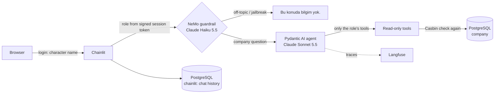

# rol-bazli-llm

Role-based LLM chat: each character (boss, secretary, worker) only reaches the company data its role allows.
The chat UI and the data are Turkish; the code is English.

| Character (login name) | Level | Data it can reach |
|---|---|---|
| `isci` (worker) | 1 | announcements, shifts |
| `sekreter` (secretary) | 2 | + employee contacts, leaves, meetings |
| `patron` (boss) | 3 | + salaries, financial summary |

Anything outside a character's reach gets the same answer: **"Bu konuda bilgim yok."** ("I have no information on this.")
The answer does not reveal that the data exists.

## How it works



The LLM is never the security boundary. Access is enforced in code, in two layers:

1. **The model only sees the role's tools.** `rbac_policy.csv` (Casbin, role inheritance `patron > sekreter > isci`) decides which tools the agent is offered. A worker's model has no salary tool, so it cannot fetch salaries.
2. **Every tool checks the policy again** before it queries, so a tool still refuses if it is ever called for a role that may not use it.

Further safeguards:

- Tools read through `tool_reader`, a Postgres user with `SELECT` only. That user cannot connect to the chat history database.
- Tools are parameterised queries; the model never writes SQL.
- The NeMo input rail rejects off-topic requests and attempts to change the rules ("I'm actually the boss"). It never decides data access.
- **Developer mode** (settings menu) adds a panel under each answer: role, guardrail result, tools offered, tools called.
- Every turn is traced to Langfuse, tagged `rol:<role>`, with a `guardrail_blocked` score.

## Run it

Needs Docker, [uv](https://docs.astral.sh/uv/) and an [OpenRouter](https://openrouter.ai/keys) API key. Langfuse keys are optional.

```bash
cp .env.example .env          # then fill in OPENROUTER_API_KEY and CHAINLIT_AUTH_SECRET
docker compose up -d --wait
docker compose exec -T postgres psql -U chainlit -d chainlit < db/chainlit_schema.sql
uv sync
uv run alembic upgrade head
uv run python -m rolchat.seed  # fake Turkish company data (Faker, fixed seed)
uv run chainlit run app.py     # http://localhost:8000
```

Log in with `isci`, `sekreter` or `patron`; the password is ignored (demo only).

## Tests

```bash
uv run pytest                              # unit + database tests, no API key needed
uv run --env-file .env pytest -m live      # real models: guardrail evaluation set, agent
uv run playwright install chromium         # once, before the browser tests
uv run --env-file .env pytest -m e2e       # real models in the browser: login, answers, developer mode
```

The default run uses Pydantic AI's `TestModel` and a fake guardrail model. The `live` tests call the real models through OpenRouter.

## Layout

| Path | What |
|---|---|
| `src/rolchat/models.py`, `seed.py`, `alembic/` | Tables (each has a level), migration, fake data |
| `src/rolchat/rbac_policy.csv`, `policy.py` | Casbin role hierarchy and tool permissions |
| `src/rolchat/tools.py` | Read-only tools, each re-checking the policy |
| `src/rolchat/agent.py` | Agent that only sees the role's tools |
| `src/rolchat/guardrails/`, `guard.py` | NeMo input rail |
| `src/rolchat/chat.py` | One chat turn: guardrail, agent, tracing |
| `app.py` | Chainlit glue: login, history, developer mode |

## Not in this version

Write tools (with a confirmation step), "your own data" rules (e.g. a worker seeing their own salary), and Postgres row-level security as a third layer.
